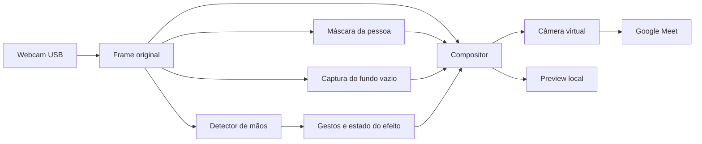

# Roadmap: câmera virtual e invisibilidade por gestos

Planejamento e pesquisa em 02/11/2026. Objetivo: publicar o vídeo processado pelo
nosso programa como câmera no Google Meet e permitir desaparecer/reaparecer por
gesto, usando uma captura prévia do ambiente vazio.

Este documento define um novo software, separado de `hand-esp`, Libras e
geometria. A saída virtual com marcações foi implementada como `hand-effects`;
consulte [preparação e comandos](hand_effects.md). Ainda não há aplicativo de
invisibilidade. O usuário confirmou a câmera virtual e as marcações no Meet;
orientação no destinatário e estabilidade prolongada ainda precisam de validação.

## Decisões iniciais

- Python/OpenCV continuam na captura e composição; reutilizar o rastreamento
  de mãos e a estabilização de dedos já existentes.
- O novo programa roda no Mac. Não depende de ESP, Raspberry ou alteração dos
  firmwares; os LEDs que funcionaram continuam como experimento independente.
- Preparar um frame de saída com apenas vídeo/efeitos desejados e uma janela
  local de controle. O painel lateral, logs e máscara de diagnóstico ficam locais.
- Usar câmera virtual baseada no OBS; iniciar pela validação do caminho até o
  Meet, antes de integrar um novo modelo de visão.
- Começar com câmera fixa, uma pessoa e fundo sem movimento. Melhorar a
  composição depois de validar a cadeia completa.

## 1. Como o vídeo aparece no Meet

Fluxo recomendado após configurar a extensão do OBS:

```text
Webcam USB → Python: mãos/efeito → pyvirtualcam → OBS Virtual Camera → Meet
```

O `pyvirtualcam` envia frames pelo dispositivo virtual instalado pelo OBS. Na
rota direta, o OBS serve para instalação/configuração inicial e depois fica
fechado; o Python passa a ser o produtor dos frames. O dispositivo do OBS é
único: não tentar usá-lo simultaneamente como saída do Python e de uma cena OBS.
Em macOS 13+, a documentação atual pede OBS 30+ e pyvirtualcam 0.14+.
[Fonte: projeto pyvirtualcam](https://github.com/letmaik/pyvirtualcam#macos-obs).

Uma alternativa para os programas que já abrem janela é:

```text
Python: janela só com vídeo → captura de janela no OBS → câmera virtual → Meet
```

O OBS oferece captura de janela pelo ScreenCaptureKit e pode publicar a cena
pela câmera virtual. Nessa alternativa, OBS permanece aberto; criar uma janela
de vídeo sem painel ou recortar a fonte para não transmitir os controles.
[Captura no macOS](https://obsproject.com/kb/macos-screen-capture-source),
[câmera virtual OBS](https://obsproject.com/kb/virtual-camera-guide).

No Meet, escolher **OBS Virtual Camera** em **Configurações → Vídeo → Câmera**,
após iniciar o produtor de vídeo. O microfone continua selecionado separadamente
no Meet. [Configurações do Meet](https://support.google.com/meet/answer/10409699?hl=pt-BR).

Autorizar a extensão de câmera do OBS nos ajustes do macOS quando solicitado.
A localização da autorização varia por versão do sistema; usar o procedimento
atual do projeto. [Instalação e compatibilidade](https://obsproject.com/kb/virtual-camera-troubleshooting).

## 2. Como a invisibilidade funciona

1. Fixar a câmera e iniciar uma contagem regressiva para sair da imagem.
2. Capturar e confirmar o fundo vazio, chamado aqui de fundo de referência.
3. Voltar à cena e continuar processando o vídeo original.
4. Identificar a região da pessoa e substituí-la pelos mesmos pixels do fundo.
5. Alternar o efeito por gesto, com uma transição curta.

O primeiro protótipo pode simplesmente exibir a foto inteira enquanto o modo
invisível estiver ativo. Isso permite testar o efeito e o retorno rapidamente,
mas congela também qualquer movimento do cenário. Depois, substituir apenas a
região da pessoa e manter o resto do vídeo ao vivo.

Para essa versão seletiva, com máscara `M=1` na pessoa e força do efeito `a`:

```text
saida = original × (1 − a × M) + fundo_referencia × (a × M)
```

`a=0` mantém a pessoa visível; `a=1` substitui sua região pelo fundo. A confiança
do segmentador pode formar uma máscara suave; ainda será necessário tratar
bordas, falhas e oscilações. Modelos e limites estão nas
[notas técnicas](../research_notes/video_effects/virtual_camera_and_invisibility.md).

## Arquitetura proposta



**O detector de gestos sempre recebe o original.** Se receber a imagem já
composta, pode deixar de encontrar a mão invisível e impedir o reaparecimento.
Preview, vídeo publicado e diagnóstico devem ter saídas independentes.

## Etapas e critérios para avançar

| Etapa | Entrega | Verificação |
|---|---|---|
| E0 · Pesquisa | Arquitetura, fontes e divisão do trabalho | Concluída neste documento; sem alegação de teste no Meet |
| E1 · Vídeo processado no Meet | Webcam com desenho das mãos e texto de teste, publicada como câmera | Outro participante/janela confirma vídeo em movimento, cores e texto legível; cinco minutos sem travar |
| E2 · Captura do fundo | Contagem regressiva, captura e preview do ambiente vazio | Usuário confirma fundo sem pessoa; troca de câmera/resolução invalida a referência |
| E3 · Invisibilidade inicial | Alternar vídeo/foto do fundo por tecla e fazer transição | Desaparecer/reaparecer localmente e no Meet; sem permitir ativação sem referência |
| E4 · Remoção seletiva | Máscara de pessoa + fundo capturado; cenário restante ao vivo | Pessoa parada e andando, braços e mãos; visualizar a máscara em diagnóstico local |
| E5 · Controle por gestos | Gesto confirmado alterna visível/invisível sem teclado | Dez ciclos consecutivos de ida/volta; um gesto mantido gera só uma ação; detector segue ativo no original |
| E6 · Qualidade e desempenho | Reduzir halos, sombra residual e flicker; controlar atrasos | Sessão com iluminação real; medir FPS e latência completa; aceitar ou trocar o modelo com base no teste |

Os critérios são metas de validação, não resultados já medidos.

### E1 · Primeiro entregável

- Instalar/configurar OBS e validar a extensão no macOS.
- Criar a saída independente da janela de controle.
- Publicar um frame com cores conhecidas, contador e texto assimétrico `ABC123`.
- Conferir orientação no destinatário, evitando decidir apenas pelo preview.
- Incluir o desenho das mãos e confirmar no Meet, com os efeitos de fundo do
  próprio Meet desativados durante o teste.
- A câmera física pertence ao Python. Na rota de captura de janela, OBS captura
  a janela, sem tentar abrir a mesma webcam.

### E2–E4 · Fundo e máscara

- Capturar o fundo apenas por comando explícito, com contagem regressiva.
  Começar guardando-o em memória; salvar foto em disco será opcional.
- Manter câmera, enquadramento, orientação, resolução e iluminação consistentes.
  Se a câmera mexer, pedir nova captura em vez de prometer correção automática.
- Como baseline, testar MediaPipe Image Segmenter com modelo pessoa/fundo e
  saída de confiança; inspecionar canais/rótulos do modelo escolhido.
- Não usar apenas subtração de frames: ela pode confundir sombras/movimento e
  não resolve bem a pessoa parada. Pode ser investigada como refinamento.
- Testar cabelo, dedos finos, roupa parecida com o cenário e cadeira/objetos.
  O fundo atrás da pessoa vem da referência; sem captura limpa não existe
  recuperação confiável dos pixels ocultos.

### E5 · Gestos e estados

Proposta inicial: indicador + mindinho (`1+4`) mantidos por 0,8 s alternam o
efeito. Reutilizar a identificação individual, sem tratar a combinação como
contagem. Depois do evento, exigir liberação da pose por cerca de 0,3 s.
O gesto poderá mudar após teste de conforto/falsos acionamentos.

Estados: `SEM_FUNDO`, `CAPTURANDO`, `VISIVEL`, `DESAPARECENDO`, `INVISIVEL` e
`REAPARECENDO`. Uma perda de mão não conta como novo gesto. Sem frame válido,
interromper a ação e indicar falha local, sem enfileirar comandos antigos.
Manter tecla/controle local para reaparecer e recapturar o fundo.

### E6 · Medidas e refinamento

Começar na resolução nativa estável da USB. Medir captura, inferência de mãos,
segmentação, composição e entrega virtual separadamente, além do FPS completo.
Não importar números publicados para GPUs Nvidia ou Pixel como resultados do Mac.
Meta inicial proposta: vídeo útil a pelo menos 20 FPS; ajustar a resolução com
base na medição, sem forçar o modo 960×720 que já causou falhas neste projeto.

Usar apenas o frame mais recente quando houver atraso, sem fila crescente.
Tratar BGR/RGB, dimensionamento e orientação da referência de forma consistente.
Se houver halos/flicker, avaliar suavização temporal da máscara e um modelo de
matting mais apropriado antes de acrescentar várias correções heurísticas.

## Estado verificado e próximo trabalho

Na pesquisa inicial: macOS 26.6.2 arm64, Python 3.12.6, MediaPipe 0.10.35 e
OpenCV 4.11.0; OBS não foi encontrado e pyvirtualcam estava ausente. Na execução
da E1, foram instalados OBS 33.0.1 e pyvirtualcam 0.15.0 e criado o comando
`hand-effects`. A primeira tentativa de abrir a saída virtual informou que a
extensão precisava ser ativada pelo usuário. Depois da ativação, o usuário
confirmou a câmera virtual no Meet com marcações das mãos. Após relato de
espelhamento, a saída passou a preservar a orientação original por padrão.

Próximo trabalho: conferir orientação no destinatário e estabilidade da E1,
seguindo para captura do fundo (E2) e remoção seletiva. Os programas e a integração ESP existentes
continuam disponíveis. O novo pacote `hand_effects` contém captura, marcações,
preview e saída virtual; fundo, segmentação e composição virão nas etapas seguintes.
